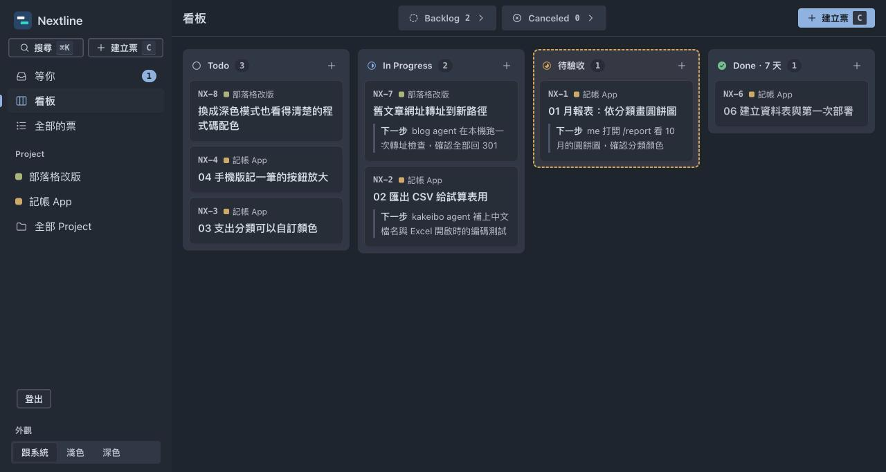

# Nextline

Nextline 是給「一個人＋幾個 AI agent」一起用的任務看板。人在網頁上開票、拖拉、驗收；Claude Code、Codex 這類 agent 透過 API 或 MCP 讀票、寫 comment、改狀態，兩邊看到同一份資料。介面是繁體中文。



- 看板、全部的票、Project、票詳細與變更紀錄（每次修改都能還原）、Cmd+K 指令面板
- 給 agent 的 REST API 與遠端 MCP（工具名稱與參數照 Linear MCP）
- 兩種跑法共用同一份核心：Node＋SQLite 自架，或 Cloudflare Workers＋D1

完整文件（安裝、agent 連線、REST API 與 MCP 參考）在官網與文件站，原始檔在 `site/`，`npm run build:site` 建到 `dist/site/` 後直接開 `dist/site/index.html`。

限制：只給單一使用者用，沒有註冊與多人帳號；所有 agent 共用一組 token，沒有個別權限。自架不需要 Cloudflare 帳號、Wrangler 或 macOS Keychain。

## 本機啟動

使用 Node **22.23.4**（`.nvmrc`／`.node-version`；可依 [Node 官方安裝方式](https://nodejs.org/en/download) 取得）：

```sh
git clone https://github.com/BolasLien/nextline.git
cd nextline
npm ci
npm run build
export NEXTLINE_DATA_DIR="$HOME/.local/share/nextline"
npm run selfhost:init
npm start
```

網頁上的人預設叫「你」（comment 作者、移票紀錄都記這個名字）；要換成自己的名字，在 `npm start` 前設 `export NEXTLINE_OWNER_NAME="你的名字"`（Cloudflare 跑法改設 `wrangler.jsonc` 的 vars `OWNER_NAME`）。agent 留言時用自己的名字，只有這個名字回覆待驗收的票會把票交回 In Progress。

初始化會在終端機詢問密碼（12–256 字元，輸入不回顯）；沒有公開註冊頁。開啟 **http://127.0.0.1:3000**，登入後就能開票、拖拉與留言。請使用該網址，不要在未修改設定時換成 localhost，因為服務會核對 Host。

資料放在 `NEXTLINE_DATA_DIR/nextline.sqlite`，與程式碼／`dist` 分開。這是專用私人資料目錄，權限設為 0700、DB 為 0600。預設即上述路徑；使用本機磁碟，不用網路共享檔案系統。SQLite 使用 WAL、外鍵及 5 秒鎖定等候；按 Ctrl+C 正常關機。重跑初始化會保留密碼、token 和既有資料，失敗的 migration 會整批撤回；較新或被改過的 migration 版本會拒絕啟動。

## Agent 連線

另開終端機，在同一個原始碼目錄及相同 `NEXTLINE_DATA_DIR` 下產生 token（與網頁密碼分開）：

```sh
export NEXTLINE_API_TOKEN="$(npm run --silent selfhost:token)"
curl -H "Authorization: Bearer $NEXTLINE_API_TOKEN" http://127.0.0.1:3000/api/issues
```

指令只回傳一次新 token。這個動作**會立刻撤銷舊 agent token**；更新 client 的環境變數後重啟 client。把 token 放在自己的密碼管理器或安全環境變數，不放進 Git。服務端只保存 SHA-256 雜湊；前端不持有 token。此版仍是單一部署共用的 agent 憑證，不提供每個 agent 的權限隔離。

MCP 使用 Streamable HTTP：網址 `http://127.0.0.1:3000/mcp`、header `Authorization: Bearer <token>`。[MCP 文件](docs/mcp.md) 列出完整 client 設定及工具；[API 文件](docs/api.md) 列出所有路徑。Codex 範例：

```toml
[mcp_servers.nextline_local]
url = "http://127.0.0.1:3000/mcp"
bearer_token_env_var = "NEXTLINE_API_TOKEN"
```

## 密碼與登出

桌面側欄、手機「更多」都有登出。登入有效期為 12 小時；過期後重新登入會回到原頁。忘記密碼時，由能操作伺服器的人執行：

```sh
npm run selfhost:password
```

這會撤銷所有舊 session，不更動 agent token。登入每分鐘全站最多 5 次嘗試（含成功），限流狀態重啟後仍有效。自動化可透過標準輸入使用 `npm run selfhost:init -- --password-stdin`，不要把密碼當命令列參數。

## 開發

先完成建置與初始化，再執行：

```sh
npm run dev
```

一個指令啟動 Node 後端（3000）與 Vite（5173），開 **http://127.0.0.1:5173**。Node 和前端變更都會重載；初次造訪仍要登入。這個開發模式只綁 loopback，固定 3000／5173，使用同一個資料目錄。正式 `npm start` 只提供建置檔，不跑 Vite。

Cloudflare 的既有開發流程保留為 `npm run dev:cloudflare`，仍使用 `.dev.vars` 與 Wrangler。`DEV_SKIP_ACCESS` **不適用 Node 跑法**；正式 Worker 的 Access／token 邊界不變。

## HTTPS 伺服器

直接對外的 HTTP 不支援。TLS 交給反向代理，Node 預設仍綁 127.0.0.1；設定公開 origin 與代理的**精確 IP**：

```sh
export NEXTLINE_DATA_DIR=/srv/nextline-data
export NEXTLINE_PUBLIC_URL=https://nextline.example.com
export NEXTLINE_TRUSTED_PROXIES=127.0.0.1
npm start
```

例如同機 Caddy 設定（網域須指到該伺服器）：

```caddyfile
nextline.example.com {
  reverse_proxy 127.0.0.1:3000 {
    header_up Host nextline.example.com
    header_up X-Forwarded-Host nextline.example.com
    header_up X-Forwarded-Proto https
  }
}
```

只有指定代理的 socket IP、正確 Host 與單一 `X-Forwarded-Proto: https` 會被接受。應限制 Node port 只讓代理連線；不信任任意 `Forwarded`／`X-Forwarded-For`，公開網址不從標頭推算。可用 `NEXTLINE_HOST` 指定綁定 IP、`NEXTLINE_PORT` 指定連接埠；非 loopback 必須有 HTTPS 與代理設定。Cookie 在 HTTPS 模式加上 Secure。[完整入口與安全矩陣](docs/auth.md#node-自架-nx-194)。[自架操作文件](docs/self-host.md#linux-https-與程序管理範例) 提供實際 Caddy＋Supervisor、獨立測試 CA、程序重啟的可重跑範例；不涉及任何正式網域部署。

## 備份、還原與更新

```sh
mkdir -p "$HOME/nextline-backups"
npm run selfhost:backup -- "$HOME/nextline-backups/backup-01"
# 停止服務，保留原資料，再還原到不存在的新目錄
npm run selfhost:restore -- "$HOME/nextline-backups/backup-01" "$HOME/.local/share/nextline-restored-01"
export NEXTLINE_DATA_DIR="$HOME/.local/share/nextline-restored-01"
npm run selfhost:init
npm start
```

備份使用 SQLite 一致性快照，含已提交 WAL；還原不覆蓋任何舊目錄。更新先停機、備份，在新程式目錄執行 `selfhost:init` 後才啟動；失敗回復須搭配舊程式與舊快照，不能只退程式碼。完整檢查步驟、憑證注意事項與重跑方式見 [自架操作文件](docs/self-host.md)。

## 驗證

```sh
npm run verify
npm run build
PLAYWRIGHT_MODULE=/path/to/playwright/index.mjs node scripts/e2e/selfhost.mjs
```

`verify` 包含 Node 真實 HTTP／MCP client，以及共用核心的 SQLite／本機 workerd D1 測試。驗證 D1 才需要開發依賴中的 Wrangler；正式 Node 服務不匯入或執行它。UI 腳本預設使用 macOS Google Chrome，可用 `CHROMIUM_PATH` 指定其他 Chrome 路徑；產物在 `.scratch/nx194/`。

實測平台、乾淨環境指令與完整 checklist 見 [自架驗收紀錄](docs/self-host-validation.md)。未驗的平台不宣稱支援。Node 22.23.4 的 `node:sqlite` 會顯示實驗性提示。

## Cloudflare Workers 部署

也可以部署到自己的 Cloudflare 帳號（Workers＋D1，人用 Cloudflare Access 登入）。先把 `wrangler.jsonc` 的 `<your-team>`、`<your-access-aud>`、`<your-d1-database-id>` 換成自己的值，設定步驟見 [驗證方式](docs/auth.md)。

## 授權

[Apache License 2.0](LICENSE)。Copyright 2026 Bolas Lien.
