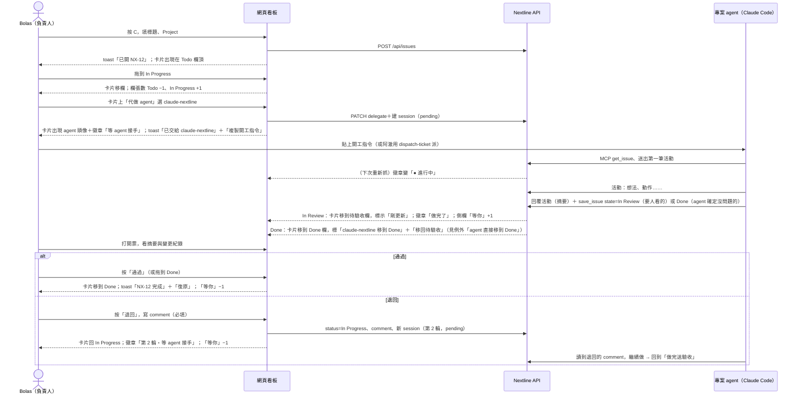

# Nextline 第二版：使用流程

> NX-147。狀態、URL、session 狀態的定義見 [README.md](README.md)；畫面長相見 [wireframes.html](wireframes.html)。
> 每一步標出畫面回饋：**toast**（右下角短訊息，桌面 4 秒、帶「復原」的 10 秒）、**卡片**（移欄、標示）、**徽章**（卡片角落的 session 狀態）、**計數**（欄標題張數、側欄「等你」張數）。

## 回饋的共通規則

| 情況 | 回饋 |
|---|---|
| 人做的變更（拖拉、改欄位） | 畫面先改（樂觀更新），API 失敗才回原位並出 toast「沒存成功：〈原因〉」＋「重試」 |
| 會讓票離開目前畫面的變更（移到 Done、取消、封存） | toast 帶「復原」10 秒 |
| agent 做的變更 | 下次重新抓資料時卡片移到新位置，外框標示「剛更新」5 秒，滑過顯示「claude-nextline 移到待驗收・2 分鐘前」 |
| agent 把票移到 Done | Done 欄的卡片標「claude-nextline 移到 Done・3 分鐘前」＋「移回待驗收」，看過或 24 小時後收起；變更紀錄隨時能一鍵還原 |
| 輪到人的事出現（待驗收、等你回覆、出錯） | 側欄「等你」張數 +1；分頁標題前加 `(n)` |
| 拖曳中 | 能放的欄亮起；收起的 Backlog、Canceled 展開成放置區。任何票都能直接拖到 Done，不跳確認；放下後 toast「復原」 |

---

## 核心流程：開票 → 交給 agent → 驗收



逐步對照（同一張票 NX-12）：

| # | 使用者做什麼 | 在哪裡 | 畫面回饋 |
|---|---|---|---|
| 1 | 按 `C`（或側欄「＋ 開票」、欄標題旁的「＋」） | 任何畫面 | 開票對話框打開，游標在標題；從某欄的「＋」開的，狀態已預填那欄 |
| 2 | 打標題；按 `P` 選 Project（產品不放 Sprint，NX-160） | 對話框 | 選完的值變成標題下方的晶片（Project・Todo） |
| 3 | `Cmd+Enter` 建立 | 對話框 | 對話框關閉（勾「繼續開下一張」就留著並清空）；toast「已開 NX-12」＋「打開」；卡片出現在 Todo 欄頂、外框標示 2 秒；Todo 張數 +1 |
| 4 | 把卡片拖到 In Progress | 看板 | 拖曳時 In Progress 欄亮起；放下後卡片停在欄頂；兩欄張數更新 |
| 5 | 滑過卡片點 agent 位置的「＋」（或選取後按 `D`），選 `claude-nextline` | 看板卡片 | 卡片出現 agent 頭像；徽章「等 agent 接手」；toast「已交給 claude-nextline」＋「複製開工指令」 |
| 6 | 按「複製開工指令」，貼到 nextline repo 的 Claude Code 視窗 | toast／票詳細頁 | toast「已複製」 |
| 7 | （agent）讀票、開始做 | — | 下次重新抓：徽章變「● 進行中」，旁邊寫最後活動時間（「1 分鐘前」） |
| 7a | （agent 有問題）送出問人活動 | — | 徽章「等你回覆」；側欄「等你」+1；問題出現在票的 comment |
| 7b | Bolas 回 comment | 票詳細頁 | comment 出現；agent 讀到後徽章回「● 進行中」 |
| 8 | （agent）送出摘要、移到待驗收 | — | 卡片移到待驗收欄並標示「剛更新」；徽章「做完了」；「等你」+1 |
| 9 | 點卡片 | 看板 | 右側預覽打開；最上方是驗收列：agent 的摘要＋「通過」「退回」 |
| 10a | 按「通過」 | 預覽／詳細頁 | 卡片移到 Done；toast「NX-12 完成」＋「復原」10 秒；「等你」−1 |
| 10b | 按「退回」 | 預覽／詳細頁 | 驗收列展開成 comment 輸入框（必填，按鈕在寫字前是停用的）；送出後卡片回 In Progress，徽章「第 2 輪・等 agent 接手」，toast「已退回 claude-nextline」 |

例外：

- **agent 一直沒接手**：徽章停在「等 agent 接手」，超過 30 分鐘變「還沒開工」，票進「等你」，提醒去貼開工指令。
- **agent 出錯**：徽章「出錯」，滑過顯示錯誤第一行；票進「等你」。票詳細頁的 session 面板有「重新交給 agent」（開新一輪）與「移除 agent」。
- **太久沒更新**：`active` 超過 30 分鐘沒活動，徽章「太久沒更新・42 分鐘」；票進「等你」。
- **要叫 agent 停**：票詳細頁 session 面板第一屏的「停止」→ 徽章「停止中…」→ agent 下一次呼叫 MCP 收到停止訊號、回報後「已停止」。
- **不交給 agent，自己做**：第 5 步跳過；做完直接拖到 Done，或自己拖到待驗收留給之後看。
- **agent 直接移到 Done**：第 8 步 agent 改成 Done 而不是待驗收（人和 agent 都能移到 Done）。卡片出現在 Done 欄，標「claude-nextline 移到 Done・3 分鐘前」；Bolas 覺得不對就按卡片上的「移回待驗收」，或在變更紀錄按「還原」，接著照第 10b 步退回。
- **做錯了移回來**（不論誰移的）：

  ```
  剛移完 10 秒內  ─▶ toast「復原」或 Cmd/Ctrl+Z           ─▶ 卡片回原欄，toast「已復原」
  agent 移的     ─▶ Done 卡片「移回待驗收」                ─▶ 卡片到待驗收欄，「等你」+1
  任何時候       ─▶ 票詳細頁／預覽面板 → 變更紀錄 →「還原」 ─▶ 該欄位改回舊值；變更紀錄多一筆「Bolas 還原了…」，被還原的那筆標「已還原」
  ```

---

## 次要流程

### 1. 封存與取消封存（NX-160；不做 view，原本的「存成 view」流程拿掉）

```
票詳細（預覽或整頁）右上「⋯」→「封存這張票」（或開著票時 Cmd+K「封存這張票」）
   ▼
卡片馬上從看板、列表消失，側欄張數跟著變；toast「已封存 NX-12」＋「復原」
   │ 按「復原」 ──▶ 卡片回原本那一欄；toast「已復原」
   ▼
全部的票 → 篩選列「已封存」（/issues?archived=1） ──▶ 只列封存的票，每列右邊「取消封存」
   │ 按「取消封存」
   ▼
那一列淡出、回到看板與列表；toast「已取消封存 NX-12」＋「復原」
用網址直接打開已封存的票 ──▶ 頂端「已封存」一條＋「取消封存」
```

### 2. Cmd+K

```
任何畫面按 Cmd+K
   ▼
面板打開，輸入框是空的；下面三組：
  ├─ 對這張票（只有選取或打開某張票時出現）：改狀態、交給 agent、通過、退回、移回待驗收（Done 的票）、封存／取消封存、複製連結
  ├─ 跳到：看板、全部的票、等你、各 Project
  └─ 最近看過的票（5 張）
   │ 打字「12」或「看板」
   ▼
同時比對：票號（NX-12）、票標題、動作名稱、頁面名稱；結果分組，最佳的在最上面
   │ Enter
   ▼
跳頁：面板關閉並換頁　／　動作：第二層選單（例：「交給 agent」→ agent 清單）→ 完成後 toast，與用滑鼠做的回饋相同
```

### 3. 批次修改

```
看板或列表上 X 選第一張（或滑過卡片點左上角勾選框）
   ▼ Shift＋點 選範圍；Cmd/Ctrl+A 選目前畫面全部
畫面底部浮出操作列「已選 4 張｜狀態｜Project｜代做 agent｜…｜取消選取」
   ▼ 點「Project」→ 選 Gem TD
4 張卡片同時更新；若移出目前畫面的範圍，卡片淡出
toast「已把 4 張移到 Gem TD」＋「復原」10 秒
```

- 批次「通過」只對待驗收的票有效；選到其他狀態的票，按鈕上寫「通過（3／4 張可用）」。
- 批次不能「退回」，因為退回要逐張寫 comment。

### 4. 第一次使用（空狀態引導）

```
第一次打開 /
   ▼
看板不是空的：內建範例 Project「範例：一個 repo、兩個 agent」，4 張範例票分在 Todo、In Progress、待驗收、Done，
其中一張掛著範例 agent 與「進行中」徽章，示範卡片怎麼讀
   ▼
看板上方固定一張「開始使用」清單（側欄也有進度 0／4）：
  ① 按 C 開第一張票            ──▶ 開完打勾，toast「第一張票！」
  ② 把它拖到 In Progress        ──▶ 打勾
  ③ 連上你的 agent（複製 MCP 設定） ──▶ 前往 /settings/connect；agent 第一次呼叫 MCP 後自動打勾
  ④ 把票交給 agent               ──▶ 打勾；清單收起成側欄的一行「完成！」
   ▼
清單右上「清掉範例」：範例 Project 與範例票一起移到 Canceled；toast＋「復原」
```

- 沒有票的欄顯示一句「拖一張票過來」或「agent 做完的票會出現在這裡」（待驗收欄），不放插圖。
- 沒有符合篩選的結果時：「沒有符合的票」＋「清除篩選」。

### 5. 從手機快速看「輪到我的」

```
手機打開 Nextline（首頁仍是看板，一次看一欄）
   ▼ 底部分頁列「等你 (3)」
/me：三組，每組最多先顯示 5 張
  ├─ 等你回覆／出錯（1）：卡片上直接寫 agent 的問題第一行
  ├─ 待驗收（2）：卡片上寫 agent 的摘要第一行
  └─ 你自己做的（Todo／In Progress 沒有代做 agent）
   ▼ 點一張待驗收的票
票詳細頁：最上方是 agent 摘要；底部固定「退回」「通過」兩顆按鈕（拇指範圍）
   ▼ 按「通過」
回到 /me，那張票淡出；toast「NX-12 完成」＋「復原」；分頁列「等你 (2)」
```

- 回覆 agent 的問題：在詳細頁底部的 comment 框打字送出；送出後徽章變回「進行中」要等 agent 讀到，畫面上先顯示「已回覆，等 agent 讀取」。
